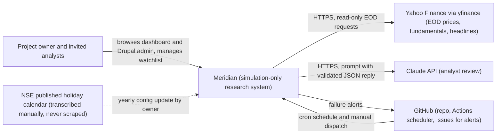
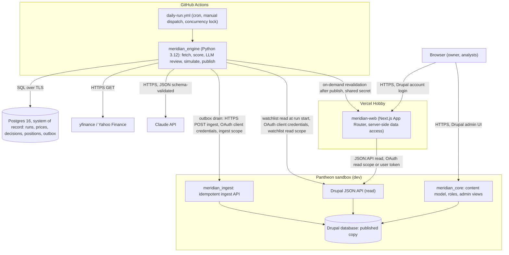
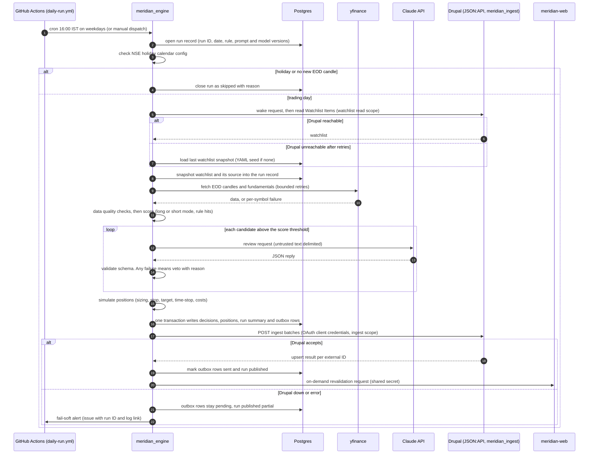

# Meridian: Solution architecture

| Field | Value |
|---|---|
| Task | T02 |
| Author | solution-architect |
| Date | 2026-11-01 |
| Status | Approved (technical-architect sign-off 2026-11-01) |
| Plan | `docs/tasks/T02/plan.md` |
| Covers | R-01 to R-12 |

This document sets out what Meridian is and where its boundaries are. It also records the
measurable targets that later tasks must meet. Technical detail (content model, Postgres
schema, OpenAPI contract, environment matrix) belongs to T03. Scoring thresholds and rule
values belong to T16 (`docs/specs/rules.md`). This document only states that they exist.

Requirement IDs (`FR-nn`, `NFR-nn`) are stable. Never renumber them after sign-off. Add new
IDs at the end instead.

## Summary

Meridian is a **simulation-only** research agent for NSE (India) equities. It never places
real orders and has no live trading capability (ADR-0006). Once per trading day the Python
engine (`meridian_engine`) does the following:

1. Fetches end-of-day data for a configurable watchlist.
2. Scores each symbol in long or short mode.
3. Asks Claude for an analyst review, which can veto a buy.
4. Simulates virtual positions with costs.
5. Stores everything in Postgres, the system of record.
6. Publishes a copy to headless Drupal 11 on Pantheon.

The authenticated Next.js dashboard (`meridian-web`, on Vercel) reads that copy through
JSON:API. The whole stack also runs locally under DDEV (project `meridian`).

## Scope and non-goals

### In scope

- Daily analysis of a watchlist of up to 50 NSE symbols, in long (fundamental) and short
  (technical) scoring modes (R-01, R-02).
- An LLM analyst review that can only veto. Any failure counts as a veto (R-03).
- Simulated positions with risk-based sizing, stop, target, time-stop and transaction
  costs (R-04).
- Full provenance and replay of every decision (R-06).
- Drupal admin browsing and export, plus an authenticated Next.js dashboard (R-07 to R-09).
- A scheduled, holiday-safe, idempotent run that raises alerts (R-10).
- A local DDEV stack and free-tier dev deployments (R-11), with tests and docs for every
  task (R-12).

### Non-goals

- **No live trading.** This project has no order placement, no broker SDK or API client,
  no broker credentials and no broker trading domains (ADR-0006). Any future broker work is
  a separate project that needs its own regulatory review (T33).
- No public publication of recommendations, no paid users and no investment advice. The
  dashboard is private (see RK-06).
- No intraday or real-time data. Meridian uses end-of-day (EOD) data only.
- No derivatives, no short selling of stock, and no exchanges other than NSE.
- No historical backtester in this phase. It is a T33 backlog candidate.
- Not decided in T02:
  - Content-type fields, Postgres DDL, API paths and the environment matrix (T03).
  - Rule thresholds (T16).
  - The prompt text (T17).
  - The hosted Postgres vendor (T03 or T28).

## Assumptions

| ID | Assumption | Consequence if false |
|---|---|---|
| A-01 | The watchlist has at most 50 symbols | Run duration and LLM cost targets (NFR-01, NFR-08) need revisiting |
| A-02 | The project is personal and non-commercial: no fees, ads or paying users | The Vercel Hobby terms are breached (RK-09). SEBI exposure rises (RK-06) |
| A-03 | Dashboard users are the owner plus at most 5 invited reviewers. There is no public sign-up | The auth design (ADR-0005) and the SEBI posture need review |
| A-04 | At most 10 symbols per run pass the score threshold and reach the LLM. Each call uses about 5,000 input and 1,000 output tokens | LLM cost (NFR-08) changes proportionally |
| A-05 | Yahoo Finance via `yfinance` stays usable for EOD candles at about 50 to 100 requests per day | Fall back to the provider interface (T15). See RK-01 |
| A-06 | The EOD candle for a trading day is available from the data source by 16:00 IST | Runs mark the day `skipped` wrongly. Measured in T15 and tracked as OQ-04 |
| A-07 | NSE normal-market hours end at 15:30 IST. The pre-open session ends at 09:15 IST ([NSE pre-open](https://www.nseindia.com/products-services/equity-market-pre-open), checked 2026-11-01). The 15:30 close comes from secondary sources and is **unverified** | The 16:00 IST schedule must move |
| A-08 | Free tiers stay as recorded in the cost map (checked 2026-11-01) | Re-check at T28 and T33 (RK-03) |
| A-09 | The data volume is small: under 100 MB a year in Postgres (decisions with raw LLM output, about 10 KB each) | A free Postgres tier may not be enough (RK-10) |

## Context diagram

The context diagram shows Meridian as one system with its users and external services.

No arrow leads to an exchange or a broker. Meridian sends no orders anywhere (ADR-0006).

## Container diagram

The container diagram shows the deployed dev containers. Local DDEV runs the same containers
(see the environment table below).

| Container | Dev hosting | Local (DDEV) | Notes |
|---|---|---|---|
| Engine `meridian_engine` | GitHub Actions runner (`daily-run.yml`) | `meridian-engine` container | Stateless. All state lives in Postgres |
| Postgres 16 | Neon Free (chosen in T03, OQ-01; provisioned in T28) | `meridian-postgres` container | System of record (ADR-0003) |
| Drupal 11 (`meridian_ingest`, `meridian_core`) | Pantheon sandbox, dev environment | DDEV `web` and `db` | Headless. Holds the published copy (ADR-0001) |
| Dashboard `meridian-web` | Vercel Hobby | `meridian-web` container | Server-side calls to Drupal only. Tokens never reach the browser |
| LLM | Claude API | Claude API, or a fake client in tests | Model name comes from config |

## Data flow

### Daily run (write path)

1. Postgres is written first and in one transaction. Drupal receives a copy afterwards
   through the outbox, so a Drupal outage never loses data (FR-14, NFR-15).
2. Every published record carries a stable external ID. Re-publishing the same record
   performs an upsert, so repeated runs are idempotent (FR-24).
3. The LLM can only turn a BUY into a veto. It never creates a BUY (FR-05 to FR-07).
4. The run reads only the watchlist from Drupal. If Drupal is down or still asleep after the
   wake and retry, the run continues with the last Postgres snapshot (or the YAML seed on
   the very first run) and records the source. A run never fails because Drupal is
   unavailable (FR-01, ADR-0003).
5. The outbox is drained at the end of every run. Between runs, the owner can drain it with
   a manual `publish` dispatch of `daily-run.yml`. There is no separate drain schedule
   (NFR-15).

### Dashboard read path

1. The user signs in to `meridian-web` with a Drupal account (ADR-0005).
2. `meridian-web` server code calls Drupal JSON:API. It uses either a read-only OAuth client
   (fields every role may see) or the user's own token (administrator-only fields such as the
   raw LLM output), so Drupal enforces field access.
3. Caching has two layers:
   - Drupal cache tags keep Drupal's own caches fresh after an ingest (T11).
   - `meridian-web` caches JSON:API responses in the Next.js data cache with time-based
     revalidation, for example 300 s. After a successful publish, the engine also calls a
     `meridian-web` revalidation route, authenticated by a shared secret, so new data
     appears at once. If that call fails, time-based revalidation still refreshes the data.

   T03 fixes the interval, the route and the secret in the env matrix. When the Pantheon
   container is asleep, the page shows the last good data with a "data as of" label while
   Drupal wakes (RK-04).

### Admin path

Administrators and analysts use Drupal's admin UI directly on Pantheon. Views provide
filtering and CSV export (FR-15).

Watchlist Items are managed only in Drupal, which is authoritative for the watchlist. The
engine reads them at the start of each run through a read-only watchlist scope and
snapshots them into Postgres. If Drupal is unreachable, it falls back to the last snapshot
and then to the YAML seed (FR-01).

## Requirements

Each seed requirement R-01 to R-12 (`docs/TASKS.md` section 2) is the parent of one or more
refined requirements. Priority uses MoSCoW. Targets name the environment:

- **DDEV**: the local stack.
- **Dev**: the deployed Pantheon sandbox, Vercel Hobby, GitHub Actions and hosted Postgres.

Where cold starts apply, warm and cold are measured separately. T03 may tighten a target but
must not loosen one without an ADR. The exception is NFR-04 and NFR-05: T03 may set their
final values in either direction from a recorded DDEV measurement (OQ-07).

### Functional requirements

| ID | Parent | Requirement | Priority | Target | Verifying task |
|---|---|---|---|---|---|
| FR-01 | R-01 | The watchlist is configurable without code changes. Drupal Watchlist Items are authoritative. The engine reads them at run start through a read-only watchlist scope and snapshots them into the run record in Postgres. If Drupal is unreachable after wake and retry, the engine uses the last snapshot, or the YAML seed in engine config when no snapshot exists. Each run logs which source it used | Must | 1 to 50 NSE symbols. A Drupal change takes effect on the next run with 0 code changes. 100% of runs record the watchlist source (drupal, snapshot or seed) | T10, T12, T13 |
| FR-02 | R-01 | The engine analyses every enabled watchlist symbol once per trading day | Must | 100% of enabled symbols get a decision or a logged per-symbol failure reason on every trading day | T15, T31 |
| FR-03 | R-02 | There are two scoring modes, long (fundamental) and short (technical). Every decision records its mode | Must | 2 modes. 100% of decisions have mode in {long, short} | T16 |
| FR-04 | R-02 | Each decision has a score, the rule hits (rule IDs from `docs/specs/rules.md`) and the rule version | Must | Score 0 to 100. 100% of decisions carry rule IDs and a rule version. Each threshold is tested at 3 points (below, at, above) | T16 |
| FR-05 | R-03 | The LLM review runs only for candidates above the score threshold. It can veto a buy and never create one | Must | LLM calls equal the number of candidates above the threshold (counted in tests). 0 BUY actions created by the LLM | T17 |
| FR-06 | R-03 | Any LLM failure counts as a veto, and the reason is stored | Must | 5 failure types (malformed, empty, timeout, API error, schema violation) each yield a veto in 100% of tests | T17 |
| FR-07 | R-03 | Untrusted text (headlines, LLM output) cannot change the output schema or produce an unvalidated buy | Must | 0 unvalidated BUY results in the prompt-injection set, with at least 1 injection case per untrusted input field | T17, T30 |
| FR-08 | R-04 | Position size is risk-based: it follows from capital, the risk-per-trade cap and the position cap | Must | Size exceeds neither cap in 100% of sizing tests. Zero or negative risk per share opens 0 positions | T16, T18 |
| FR-09 | R-04 | Every simulated position has a stop and a target, plus a time-stop in short mode. Exits follow the gap and same-bar rules in T18 | Must | At least 12 hand-calculated scenarios pass | T18 |
| FR-10 | R-04 | Transaction costs (brokerage, STT, exchange and regulatory charges, GST, stamp duty) apply to both sides, with rates from config | Must | The accounting invariant (equity = start capital + realised + unrealised P&L - costs) holds at 100% of steps | T18, T25 |
| FR-11 | R-05 | No live order capability: no broker SDK, broker API client, order-placement code or broker trading domain anywhere in the repo | Must | 0 hits from the static broker check in CI and in the T30 manual review | T18, T30, T33 |
| FR-12 | R-06 | Every decision stores its inputs snapshot, raw LLM output, prompt version, model name and rule version | Must | All 5 provenance fields are non-null on 100% of decision rows | T14, T17 |
| FR-13 | R-06 | Any past trading day can be replayed from stored inputs | Must | `replay --date D --no-llm` reproduces 100% of scores and pre-LLM actions for D | T20, T27 |
| FR-14 | R-06 | Postgres is the system of record. Drupal holds a published copy that reconciles with it | Must | 0 count or key-value differences between Postgres and Drupal after a publish (reconciliation script) | T19, T27 |
| FR-15 | R-07 | Drupal admin views for Decisions, Positions and Daily Runs, with exposed filters and CSV export | Must | 3 views. CSV export row count equals the filtered row count | T12 |
| FR-16 | R-07 | Drupal roles: at least `administrator`, `analyst` (read and export only), `engine-ingest` (engine client) and `dashboard-read` (Next.js read client). T03 fixes the final list | Must | At least 4 roles. 100% of cells in the T09 permissions matrix pass tests | T09, T12 |
| FR-17 | R-08 | Dashboard pages: overview, decisions explorer, positions and reports. Each has empty, loading and error states | Must | 4 page areas, with 3 states each tested | T23, T24, T25 |
| FR-18 | R-08 | Dashboard numbers reconcile with the engine `report` output | Must | Differences of at most ₹0.01 for amounts and 0.01 percentage points for returns | T23, T25 |
| FR-19 | R-09 | Every dashboard page and data route requires authentication | Must | 100% of routes return a login redirect or 401 when unauthenticated | T22, T30 |
| FR-20 | R-09 | Least privilege: separate OAuth clients for the engine (ingest write plus watchlist read only) and Next.js (read only). Raw LLM output is visible to administrators only | Must | 0 forbidden cells pass in the authorisation matrix (every role against every endpoint and page) | T10, T11, T22, T30 |
| FR-21 | R-09 | Tokens and Drupal credentials never reach the browser | Must | 0 tokens or secrets in client bundles and browser network traces | T22, T30 |
| FR-22 | R-10 | A scheduled daily run on weekdays after market close, with a manual trigger and a concurrency lock | Must | Cron at 16:00 IST (10:30 UTC), Monday to Friday. At most 1 run in progress | T20 |
| FR-23 | R-10 | An NSE holiday, or no new EOD candle, ends the run with status `skipped` and a reason | Must | 100% of holiday fixtures yield `skipped`. 0 decisions written for that date | T20 |
| FR-24 | R-10 | Re-running the same date is idempotent in Postgres and Drupal | Must | 0 duplicate records after 2 runs for the same date (counts compared before and after) | T14, T19 |
| FR-25 | R-10 | A failed run or a failed publish raises an alert with the run ID and a log link. A failed publish marks the run `published: partial` | Must | 1 notification per failed run (forced-failure test) | T19, T20, T29 |
| FR-26 | R-11 | The whole stack runs locally under DDEV with extra Docker services | Must | 4 services up after `ddev start` from a clean clone: Drupal, `meridian-postgres`, `meridian-engine`, `meridian-web` | T05, T06, T27 |
| FR-27 | R-11 | Deployed dev mirrors local: Drupal on Pantheon dev, the dashboard on Vercel, the engine on GitHub Actions and Postgres on a free host | Should | 1 unattended scheduled run is visible in the deployed dashboard | T07, T28 |
| FR-28 | R-12 | Every task has a plan, test cases, a test report and a review in the repo | Must | 100% of tasks T00 to T33 have these 4 artifacts at close | T32 |
| FR-29 | R-12 | The traceability matrix links every requirement to tasks, test cases and evidence | Must | 0 requirement rows without a test case and evidence at T32 | T04, T32 |
| FR-30 | R-08 | A "simulated research output, not investment advice" notice is shown in the shared dashboard layout and on every dashboard page, and as a header line in every CSV export (Drupal Views and dashboard) | Must | Notice present on 100% of dashboard pages and in 100% of CSV exports | T12, T22, T23, T24, T25 |

### Non-functional requirements

| ID | Parent | Requirement | Priority | Target | Verifying task |
|---|---|---|---|---|---|
| NFR-01 | R-10 | Engine run duration (daily run end to end, including the LLM and publish) | Must | DDEV with the fake LLM: at most 5 min for 50 symbols. Dev (GitHub Actions runner, real LLM): p95 at most 15 min over the T31 window. Job timeout 30 min | T20, T30, T31 |
| NFR-02 | R-10 | Data freshness: a trading day's results are visible in the dashboard | Must | Dev: by 18:00 IST on at least 90% of trading days in the T31 window. By 20:00 IST on 100% of trading days whose run ends in success or partial, counting a failed run recovered by manual dispatch before 20:00 IST as a success. The slack covers GitHub schedule delay and a Pantheon wake of about 30 s | T20, T29, T31 |
| NFR-03 | R-08 | Dashboard page load (LCP) on overview and decisions pages with 5,000 decisions seeded | Must | Dev, Drupal warm: LCP p75 at most 2.5 s. DDEV: at most 2.0 s. Drupal cold (asleep, measured separately): page shell within 2.5 s and data within 40 s | T26, T30 |
| NFR-04 | R-06 | Batch ingest time | Must | DDEV: one ingest request of 500 records completes in at most 30 s (p95 over 5 runs), and the API accepts at least 500 records per request. This is a provisional value: T03 sets the final value in either direction from a recorded DDEV measurement taken before T10. The Pantheon dev value is deferred to T03, because the Pantheon request time limit is not yet recorded; if the limit is lower, the publisher splits batches. T03 amendment: values, the T09 measurement gate and the Pantheon dev value (at most 30 s per request, provisional batch of 100) are in `technical-design.md`, section "NFR numbers owned by T03" | T10, T30 |
| NFR-05 | R-08 | Read API response time for a 50-row JSON:API page with 5,000 records seeded | Must | p95 at most 500 ms on DDEV and at most 1,500 ms on Pantheon dev (warm, wake excluded), over 50 requests. T03 amendment: provisional until the T09 measurement gate in `technical-design.md`, section "NFR numbers owned by T03" | T11, T30 |
| NFR-06 | R-10 | Run availability over the T31 window (10 to 15 trading days) | Must | 100% of trading days have a terminal run record (success, partial, or skipped with reason). At least 90% of trading days end in success or partial | T31 |
| NFR-07 | R-12 | CI pipeline duration (`ci.yml`) | Must | At most 10 min wall clock on a clean cache. At most 6 min with warm caches | T08 |
| NFR-08 | R-03 | LLM cost per run and per month | Must | Dev: at most USD 0.50 per run and USD 10 per calendar month. When a cap is reached the engine stops calling the LLM and vetoes with the reason "budget" | T17, T29, T31 |
| NFR-09 | R-11 | Recurring platform cost | Should | USD 0 per month for hosting (GitHub Actions, Postgres, Pantheon sandbox, Vercel Hobby). Only the Claude API is paid | T28 |
| NFR-10 | R-09 | Secret hygiene | Must | 0 secrets in the full git history (gitleaks). 0 secrets outside platform secret stores and local `.env` | T30 |
| NFR-11 | R-09 | Known vulnerabilities | Must | 0 unresolved high or critical findings in dependency and container image scans | T26, T30 |
| NFR-12 | R-08 | Accessibility | Must | 0 critical or serious axe violations on every page in both themes. Text contrast at least 4.5:1 (3:1 for large text and UI) | T21a, T26 |
| NFR-13 | R-08 | Self-hosted assets | Must | 0 requests to third-party hosts for fonts, styles, scripts or icons per page load | T21a |
| NFR-14 | R-10 | Alert latency | Must | A failure notification within 15 min of a failed run. A missed-run alert by 19:00 IST when a trading day has no terminal run record | T20, T29 |
| NFR-15 | R-10 | Outbox recovery after a Drupal outage | Must | 0 records lost. Drain triggers are the next scheduled run, or a manual `publish` dispatch of `daily-run.yml`. The outbox reaches 0 by the end of the next run after Drupal is back, or within 30 min of a manual `publish` dispatch | T19, T27 |
| NFR-16 | R-06 | Backup and restore of Postgres and the Drupal database | Should | RPO at most 24 h. Restore drill RTO at most 2 h. Row counts match after restore | T14, T29 |
| NFR-17 | R-11 | Local setup from a clean clone | Must | DDEV: a running stack within 30 min (image pulls included, on a connection of about 50 Mbit/s), using only README commands | T27, T32 |
| NFR-18 | R-12 | Test coverage | Must | At least 90% line coverage on the engine `scoring` and `risk` modules. Other component targets are set in T04a | T04a, T16 |
| NFR-19 | R-01 | Market data request discipline | Must | At most 2 requests per symbol per run on average. Retries are capped at 3 with exponential backoff on HTTP 429 | T15 |

Cross-check against the targets that later tasks reference:

| Task | Target |
|---|---|
| T08 | NFR-07 |
| T10 | NFR-04 |
| T11 | NFR-05 |
| T26 | NFR-03 |
| T30 | NFR-01, NFR-03, NFR-04, NFR-05 |
| T31 | NFR-01, NFR-02, NFR-06, NFR-08 |

## Risk register

Likelihood and Impact use Low, Medium and High. Owner is a role.

| ID | Risk | Likelihood | Impact | Owner | Mitigation | Task | Source |
|---|---|---|---|---|---|---|---|
| RK-01 | Free data source blocking: Yahoo Finance (through the unofficial `yfinance` library) rate-limits or blocks requests or changes its API. Its terms also bar automated collection without permission | High | High | solution-architect | Use a provider interface with a stub second provider. Retry a bounded number of times with backoff. A failed symbol is logged and the run continues. Keep request discipline (NFR-19). CI uses recorded fixtures, never the live network. Record limits in `docs/specs/data-sources.md`. Put a licensed Indian data source in the T33 backlog | T15 | [Yahoo terms](https://legal.yahoo.com/us/en/yahoo/terms/otos/index.html), [yfinance README](https://github.com/ranaroussi/yfinance), checked 2026-11-01. Actual rate limits are **unverified** |
| RK-02 | LLM wrong, hallucinated or injected output, for example a headline that tells the model to ignore the rules | Medium | High | technical-architect | Validate replies against a JSON schema. Any failure is a veto. The LLM can only veto and never creates a BUY. Fence untrusted text with clear markers in the prompt. Run injection tests. Render LLM text escaped in the UI. Store the raw output for audit | T17, T30 | n/a (project-internal risk) |
| RK-03 | Free-tier limits or terms changing: GitHub Actions, hosted Postgres, Pantheon or Vercel change quotas, pricing or eligibility | Medium | Medium | solution-architect | Re-check the cost map with dates at T28 and T33. Keep each platform behind a portable boundary (standard Postgres, Docker images, Composer-managed Drupal). The full DDEV stack stays the fallback | T28, T33 | Cost map sources, checked 2026-11-01 ([GitHub Actions billing](https://docs.github.com/en/billing/concepts/product-billing/github-actions), [Vercel Hobby](https://vercel.com/docs/plans/hobby)) |
| RK-04 | Pantheon sandbox sleep: containers sleep after about 1 h idle and take about 30 s to wake. Remote MySQL and SFTP connections fail while idle | High | Medium | developer | The engine sends a wake GET at run start, then retries with backoff for up to 120 s. The watchlist read falls back to the last Postgres snapshot, and publishing leaves records in the outbox. `deploy-drupal.yml` wakes the environment before running drush. The dashboard serves cached last-good data with a "data as of" label. NFR-03 measures cold separately | T07, T19, T26 | [Pantheon application containers](https://docs.pantheon.io/application-containers), checked 2026-11-01 |
| RK-05 | GitHub cron delay: the `schedule` event can be delayed under high load and some queued jobs dropped. In a public repo, scheduled workflows are disabled after 60 days without repository activity | High | Medium | developer | Schedule at 10:30 UTC rather than on the hour. The freshness target (NFR-02) allows 2 h of slack. A missed-run alert fires at 19:00 IST (NFR-14). A runbook covers manual dispatch, and reruns are idempotent. A weekly check confirms the workflow is enabled. An external trigger is added only if T31 shows misses | T20, T29 | [GitHub events that trigger workflows](https://docs.github.com/en/actions/reference/workflows-and-actions/events-that-trigger-workflows), checked 2026-11-01 |
| RK-06 | SEBI and regulatory exposure. Publishing research reports or buy/sell recommendations to others can fall under the SEBI (Research Analysts) Regulations, 2014, as amended 2024-12-16. Placing orders through API algos falls under SEBI's retail algo framework. SEBI also restricts regulated entities from associating with unregistered persons who give advice | Low | High | solution-architect (project owner accountable) | Simulation only, with no order capability (ADR-0006). The dashboard is private and authenticated: no public pages, no fee, at most 5 invited users (A-03). Every page and CSV export states "simulated research output, not investment advice" (FR-30). Any publication, paid use or broker work is a separate project with legal review (T33) | T22, T33 | [SEBI RA Regulations](https://www.sebi.gov.in/legal/regulations/dec-2024/securities-and-exchange-board-of-india-research-analysts-regulations-2014-last-amended-on-december-16-2024-_90153.html), [SEBI investor page on RAs](https://investor.sebi.gov.in/research_analyst.html), [SEBI algo circular extension](https://www.sebi.gov.in/legal/circulars/sep-2025/extension-of-timeline-for-implementation-of-sebi-circular-dated-february-04-2025-on-safer-participation-of-retail-investors-in-algorithmic-trading-_96979.html), checked 2026-11-01. The association rule comes from a [law firm summary](https://www.nishithdesai.com/default.aspx?id=15193). Exact regulation wording and the current algo timeline are **unverified** |
| RK-07 | Secrets leakage: an API key, OAuth client secret, Terminus token, database URL or the revalidation secret (`MERIDIAN_REVALIDATE_SECRET`) is committed, logged or exposed to the browser | Medium | High | developer | gitleaks runs in pre-commit and scans the full history in CI. Secrets come only from env vars and platform secret stores. Tokens stay server-side. Each client has a scoped, least-privilege token. Logs are redacted. A rotation runbook exists | T08, T22, T29, T30 | n/a (project-internal risk) |
| RK-08 | LLM cost overrun from retries, long prompts, a model change or a price change | Low | Medium | developer | Only above-threshold candidates call the LLM. Per-run and monthly caps (NFR-08) veto once reached. Tokens and cost are logged per call and per run. The owner sets a spend limit in the Claude Console | T17, T29 | [Claude pricing](https://platform.claude.com/docs/en/about-claude/pricing), checked 2026-11-01 |
| RK-09 | Vercel Hobby non-commercial clause: Hobby is for non-commercial personal use only. Usage over a limit pauses the feature until 30 days pass | Low | Medium | project owner | Keep the project personal and non-commercial (A-02). Keep usage far below quotas: a private dashboard with at most 6 users. Move to Pro (USD 20 per user per month) before any commercial use | T28, T33 | [Vercel Hobby](https://vercel.com/docs/plans/hobby), checked 2026-11-01 |
| RK-10 | Hosted Postgres pause or suspension. Supabase Free pauses after 7 days of low activity. Neon Free suspends compute once 100 CU-hours are used, and compute scales to zero after 5 min | Medium | Medium | technical-architect | Choose the vendor in T03 or T28 against these limits (T03 amendment: Neon Free chosen, see OQ-01). The daily run keeps the database active. Retry connections to absorb cold starts. Take a daily backup as a workflow artifact. DDEV Postgres is the fallback | T28, T29 | [Neon pricing](https://neon.com/pricing), [Supabase pausing](https://supabase.com/docs/guides/platform/free-project-pausing), checked 2026-11-01 |
| RK-11 | NSE data terms: the NSE website terms prohibit automated scraping, so the holiday calendar must not be scraped | Medium | Medium | solution-architect | Keep the holiday calendar as a committed config file, transcribed by the owner each year from NSE's published holiday list. The no-new-candle check is a second guard | T15, T20 | [NSE terms of use](https://www.nseindia.com/static/nse-terms-of-use), checked 2026-11-01. The page timed out on fetch, so the wording comes from a search snippet and is **unverified** |
| RK-12 | A small sample misleads: 10 to 15 trading days of forward returns carry no statistical weight | High | Medium | solution-architect | Reports show the sample size and a "too small to be meaningful" banner (T25). The T31 analysis carries an explicit caveat. No rule change is based on T31 results alone | T25, T31 | n/a (project-internal risk) |

## Cost map

Tier is one of free, free-with-limits or paid. The "Limit that matters" column names the
limit most likely to break the project.

| Component | Used for | Tier | Limit that matters | Source | Checked |
|---|---|---|---|---|---|
| GitHub Actions | `daily-run.yml`, `ci.yml`, `deploy-drupal.yml` | free-with-limits | Scheduled runs can be delayed or dropped under high load. In a public repo, scheduled workflows are disabled after 60 days without activity. Standard runners are free in public repos. Private repos on GitHub Free get USD 12 per month of included usage (about 2,000 Linux minutes, our calculation). Max 6 h per job | [Events](https://docs.github.com/en/actions/reference/workflows-and-actions/events-that-trigger-workflows), [billing](https://docs.github.com/en/billing/concepts/product-billing/github-actions), [limits](https://docs.github.com/en/actions/reference/limits) | 2026-11-01 |
| Hosted Postgres (candidates Neon Free and Supabase Free, chosen in T03 or T28; T03 amendment: Neon Free chosen, see OQ-01) | Engine system of record | free-with-limits | **Neon Free:** 1 GB storage per project and 100 CU-hours per month. Compute scales to zero after 5 min (cannot be disabled). Over quota, compute is suspended until the next month. **Supabase Free:** 500 MB database and 2 active projects. Paused after 1 week of low activity | [Neon pricing](https://neon.com/pricing), [Neon FAQ](https://neon.com/faqs/free-plan-limits-and-quotas), [Supabase pricing](https://supabase.com/pricing) | 2026-11-01 |
| Pantheon sandbox | Drupal dev environment | free-with-limits | Containers sleep after about 1 h idle and wake in about 30 s. Remote MySQL and SFTP fail while idle. Custom domain limit is 0, and going live needs a paid plan. PHP memory 256 MB | [Containers](https://docs.pantheon.io/application-containers), [plan resources](https://docs.pantheon.io/guides/account-mgmt/plans/resources), [pricing](https://pantheon.io/plans/pricing) | 2026-11-01 |
| Vercel Hobby | `meridian-web` dashboard | free-with-limits | Non-commercial personal use only. Monthly allowance: 1,000,000 function invocations, 4 active CPU-hours, 100 GB fast data transfer. Over a limit, wait until 30 days pass. 1 h of runtime logs. Max function duration 300 s | [Vercel Hobby](https://vercel.com/docs/plans/hobby) | 2026-11-01 |
| Claude API | Analyst review (R-03) | paid | Per-token price in USD per million input/output tokens: Sonnet 5.5 at 2/10, Sonnet 4.6 at 3/15, Haiku 4.5 at 1/5, Haiku 5.5 at 0.10/0.50 (prompts up to 100k tokens). The Batch API is 50% off. Claude 4.7 and later models use a tokenizer that produces about 30% more tokens. At A-04 volumes Sonnet 5.5 costs about USD 0.20 per run (budget in NFR-08) | [Claude pricing](https://platform.claude.com/docs/en/about-claude/pricing) | 2026-11-01 |
| Market data source: `yfinance` (Yahoo Finance) | EOD candles, fundamentals, headlines, Nifty 50 benchmark | free-with-limits | Unofficial and not affiliated with Yahoo, for "personal use only". Yahoo terms bar automated collection without prior permission and commercial reuse. Rate limits are undocumented (**unverified**) | [yfinance](https://github.com/ranaroussi/yfinance), [Yahoo terms](https://legal.yahoo.com/us/en/yahoo/terms/otos/index.html) | 2026-11-01 |
| NSE holiday calendar (reference data) | Holiday-safe scheduling (FR-23) | free-with-limits | The NSE website terms prohibit automated scraping, so the calendar is transcribed manually once a year. The wording comes from a search snippet because the page timed out (**unverified**) | [NSE terms](https://www.nseindia.com/static/nse-terms-of-use) | 2026-11-01 |
| Custom domain (.com or .in) | Not needed in dev | paid | Platform subdomains are used in dev. Pantheon sandbox allows 0 custom domains anyway. Registrar prices are **unverified** | [Pantheon plan resources](https://docs.pantheon.io/guides/account-mgmt/plans/resources) | 2026-11-01 |
| GitHub repository, issues and artifacts | Code, alerts (issues), run summaries | free | Free-plan artifact storage is 500 MB (shared with Packages). Cache storage is 10 GB per repository | [GitHub Actions billing](https://docs.github.com/en/billing/concepts/product-billing/github-actions) | 2026-11-01 |
| Local tooling: DDEV, Docker Engine, Python, Node, Drupal core | Local stack (R-11) | free | Open source. DDEV can run on Docker Engine inside WSL2 without Docker Desktop. Docker Desktop licence terms for organisations are **unverified** and not needed | n/a | 2026-11-01 |

## Glossary

### NSE and market terms

| Term | Meaning in Meridian |
|---|---|
| NSE | National Stock Exchange of India. Meridian analyses NSE cash-market equities only |
| Trading day | A weekday on which the NSE normal market is open. A trading day produces at most one completed daily run |
| Holiday calendar | The list of NSE trading holidays for the year. It is transcribed into config by the owner from NSE's published list and never scraped (RK-11) |
| Special session | An extra or unusual session, for example a short evening session on a festival day. It counts as a trading day only if the data source returns a new EOD candle |
| EOD candle | The end-of-day open, high, low, close and volume bar for one symbol on one trading day. It is Meridian's only price input |
| IST | India Standard Time (UTC+05:30). All schedule and freshness targets are in IST |
| Nifty 50 | The NSE benchmark index of 50 large companies. Meridian uses it as the comparison for returns and alpha |
| Circuit limit | The daily price band set by the exchange beyond which a stock cannot trade that day. A stock locked at its limit may have no executable price, so the simulation treats that bar conservatively (rule detail in T18) |
| STT | Securities Transaction Tax, a tax on equity trades in India. It is one of the transaction costs applied in simulation. Rates live in config, not in this document |
| Transaction costs | Brokerage, STT, exchange and regulatory charges, GST and stamp duty, all applied on both sides of a simulated trade |
| Symbol | The NSE ticker of a stock in the watchlist |
| Watchlist | The configurable list of symbols analysed each trading day (FR-01) |

### Scoring and simulation terms

| Term | Meaning in Meridian |
|---|---|
| Long mode | Long-term scoring based mainly on fundamentals. Percentage-based stop and target |
| Short mode | Short-term scoring based mainly on technical indicators. ATR-based stop and target, plus a time-stop |
| Score | A number from 0 to 100 produced by the rules for one symbol in one mode on one day |
| Rule hit | A rule (ID in `docs/specs/rules.md`) that fired for a symbol and contributed to its score |
| Rule version | The version of the rule set. It is bumped on any rule change and stored with each decision |
| Candidate | A symbol whose score passes the threshold and so goes to the LLM review |
| Decision | The action for a symbol on a day: BUY or AVOID, plus the veto flag and full provenance |
| Veto | The LLM analyst rejects a BUY candidate. Any LLM failure (malformed, empty, timeout, API error, schema violation) or a budget cap also counts as a veto |
| ATR | Average True Range, a volatility measure used to set stop and target distances in short mode |
| Stop | The price at which a simulated position exits to limit loss. A gap through the stop exits at the open |
| Target | The price at which a simulated position exits to take profit. If stop and target fall in the same bar, the stop wins |
| Time-stop | In short mode, a simulated position exits after a fixed number of trading days if neither stop nor target is hit |
| R-multiple | Profit or loss of a position divided by its initial risk (entry minus stop, times quantity). 1R means the gain equalled the risk taken |
| Forward return | The percentage price change from the decision date to 1, 3 or 5 trading days later. Used to evaluate BUY, AVOID and VETOED groups |
| Alpha | Return in excess of the Nifty 50 return over the same period |
| Virtual equity | Simulated capital: start capital plus realised and unrealised P&L, minus costs |
| Outbox | A Postgres table of records waiting to be published to Drupal. It is drained after each run and retried after outages |
| System of record | The authoritative store (Postgres). Drupal holds a published copy |
| External ID | A stable identifier on every published record that makes ingest an idempotent upsert |
| Simulation only | Meridian never places real orders. All positions are virtual (ADR-0006) |

## Open questions

| ID | Question | Owner | Resolution or ticket |
|---|---|---|---|
| OQ-01 | Which hosted Postgres vendor, Neon Free or Supabase Free? | technical-architect | Resolved in T03 (decision D-1, `docs/tasks/T03/decision-t03-design.md`): Neon Free, with Supabase Free as the fallback and a vendor-neutral schema. T28 provisions it and re-checks the limits |
| OQ-02 | Which Claude model is the default for the analyst review? | solution-architect | Ticketed to T17. Recommendation: a current Sonnet-class model, with the name in config and the NFR-08 caps enforced |
| OQ-03 | Is the GitHub repository public or private? This decides the 60-day schedule disabling and Actions billing | project owner | Ticketed to T08. Both fit the free allowance at about 22 runs of 15 min a month plus CI |
| OQ-04 | Is the EOD candle reliably available from the data source by 16:00 IST? | developer | Ticketed to T15 (measure) and T20. If not, T20 adds a second idempotent scheduled attempt before 17:30 IST |
| OQ-05 | Where does the NSE holiday calendar come from? | solution-architect | Resolved: a committed config file transcribed yearly from NSE's published holiday list, with no scraping and a no-new-candle guard. Documented in T15 `docs/specs/data-sources.md` |
| OQ-06 | Should the schedule use UTC cron (10:30 UTC) or an IANA timezone (`Asia/Kolkata`), which GitHub now supports? | technical-architect | Ticketed to T20. Either way, keep off the top of the hour |
| OQ-07 | Are the NFR-04 and NFR-05 numbers right for Pantheon and DDEV? | technical-architect | Ticketed to T03. T03 sets the final values in either direction from a recorded DDEV measurement taken before T10 starts, records the Pantheon request time limit, and sets the NFR-04 Pantheon dev value. T03 amendment: recorded in `technical-design.md`, section "NFR numbers owned by T03" (provisional values, measurement gate at the end of T09, Pantheon edge limit 59 s, at most 30 s per request) |
| OQ-08 | Should Vercel Deployment Protection (Vercel Authentication, available on Hobby) be added in front of the app login? | solution-architect | Ticketed to T22 as defense in depth for preview deployments |
| OQ-09 | Should prices be split- and dividend-adjusted for scoring and simulation? | solution-architect | Ticketed to T15, documented in `docs/specs/data-sources.md`. Adjusted series must also be stored for replay (FR-13) |
| OQ-10 | When do the branding owner actions (trademark, WHOIS, app stores, repo rename) close? | project owner | Ticketed to T33. Until then "Meridian" stays an internal codename (`naming.md`) |
| OQ-11 | Do decisions need an explicit "not investment advice" disclaimer on every page and in CSV exports? | solution-architect | Resolved: yes, as FR-30. It goes in the shared layout (T22), is verified on the pages built in T23 to T25, and appears as a header line in the T12 Drupal CSV exports |

## Related documents

- ADRs:
  - [ADR-0001 Headless Drupal with Next.js](../adr/ADR-0001-headless-drupal-nextjs.md)
  - [ADR-0002 Engine on GitHub Actions](../adr/ADR-0002-engine-on-github-actions.md)
  - [ADR-0003 Postgres as system of record](../adr/ADR-0003-postgres-system-of-record.md)
  - [ADR-0004 Monorepo with subtree deploy to Pantheon](../adr/ADR-0004-monorepo-subtree-deploy-pantheon.md)
  - [ADR-0005 Authentication](../adr/ADR-0005-authentication.md)
  - [ADR-0006 No live trading](../adr/ADR-0006-no-live-trading.md)
- [Naming and branding check](naming.md)
- [Task plan](../TASKS.md) and [traceability matrix](../TRACEABILITY.md)
- [Technical design](technical-design.md) (T03)

## Amendments

Dated follow-through edits after sign-off, allowed by T03 decision D-4. None changes an
accepted ADR or loosens an FR or NFR.

| Date | Task | Section | Change | Reviewer |
|---|---|---|---|---|
| 2026-11-01 | T03 | Container diagram table | Postgres dev hosting names Neon Free (OQ-01) | solution-architect |
| 2026-11-01 | T03 | NFR-04, NFR-05 | Pointer to the T03 values, measurement gate and Pantheon dev value (D-2) | solution-architect |
| 2026-11-01 | T03 | RK-07 | Names the revalidation secret `MERIDIAN_REVALIDATE_SECRET` (T02 review note 18) | solution-architect |
| 2026-11-01 | T03 | OQ-01, OQ-07 | Resolutions recorded (D-1, D-2) | solution-architect |
| 2026-11-01 | T03 | Related documents | Link to `technical-design.md` | solution-architect |
| 2026-11-01 | T03 | RK-10, cost map (hosted Postgres row) | Pointer to the OQ-01 resolution (T03 review note 19) | solution-architect |

## Sign-off

| Role | Name | Date | Decision |
|---|---|---|---|
| solution-architect (author) | solution-architect | 2026-11-01 | Submitted for review |
| technical-architect (reviewer) | technical-architect | 2026-11-01 | Approved. All review findings resolved on re-review (`docs/tasks/T02/review.md`). ADR-0001 to ADR-0006 accepted |
| T03 amendment | solution-architect | 2026-11-01 | Amendments table above (6 rows) reviewed by solution-architect: within the D-4 conditions, no accepted ADR changed, no FR or NFR loosened (`docs/tasks/T03/review.md`) |
