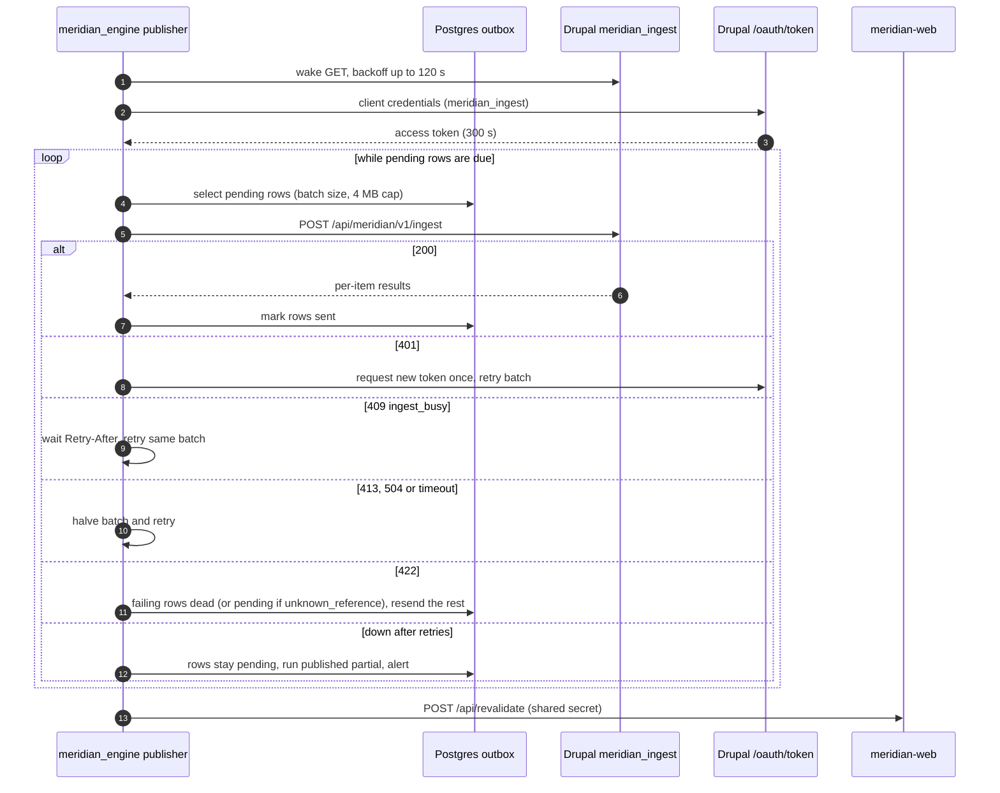

# Meridian: Technical design

| Field | Value |
|---|---|
| Task | T03 |
| Author | technical-architect |
| Date | 2026-11-01 |
| Status | Approved (solution-architect sign-off 2026-11-01, Revision 2) |
| Plan | [`docs/tasks/T03/plan.md`](../tasks/T03/plan.md) |
| Decisions | [`docs/tasks/T03/decision-t03-design.md`](../tasks/T03/decision-t03-design.md) (D-1 to D-5) |
| Builds on | [solution-architecture.md](solution-architecture.md), ADR-0001 to ADR-0006 |
| Covers | R-04, R-06, R-09 (and design elements for R-01 to R-12) |

This document turns the approved solution architecture into a buildable design. Field-level
tables live in [data-model.md](../specs/data-model.md). The ingest contract lives in
[openapi.yaml](openapi.yaml). Later tasks that build "per T03" use the names, keys, scopes,
variables and numbers here exactly. A change to any of them is a T03 amendment or an ADR.

Meridian is **simulation only** (ADR-0006). Nothing in this design sends orders anywhere. No
contract, scope, variable or host refers to a broker.

Facts this design could not check are marked **unverified** with the task that confirms them.
They are collected in the section "Unverified items".

## Requirement map

| Req | Design elements |
|---|---|
| R-01 | D1 Watchlist Item; D2 `watchlist_snapshots`; D5 watchlist read; D6 scope `meridian_watchlist_read` |
| R-02 | D1 Decision `mode`, `score`, `rule_hits`; D2 `decisions` |
| R-03 | D1 Decision `vetoed`, `veto_reason`, `raw_llm_output`; D2 `runs` LLM cost columns |
| R-04 | D1 Position; D2 `positions` (stop, target, time-stop, costs); D2 `prices` |
| R-05 | Simulation-only statement above; D5 and D7 have no broker host or credential (ADR-0006) |
| R-06 | D2 provenance columns NOT NULL; D3 idempotency; D4 outbox; D5 ingest contract; NFR-04 numbers |
| R-07 | D1 content model and roles; D6 roles and permissions |
| R-08 | D1 read fields and indexes; D6 read client and revalidation; NFR-05 numbers |
| R-09 | D6 authentication and authorisation matrix; D7 secrets matrix |
| R-10 | D2 `runs` (lock, status, `published`); D3 rerun rule; D4 retry and alerts |
| R-11 | D7 environments; D8 repo and deploy |
| R-12 | D5 lint and structural check; test hooks in each section |

## D1 Drupal content model

Five node bundles, all owned by `meridian_core` config (T09):

| Bundle | Purpose | Written by | Natural key in `external_id` |
|---|---|---|---|
| `decision` | One decision per trade date, symbol and mode | engine via `meridian_ingest` | `dec-{trade_date}-{symbol}-{mode}` |
| `position` | One simulated position | engine via `meridian_ingest` | `pos-{symbol}-{mode}-{entry_date}` |
| `daily_run` | One run summary per trade date (latest attempt) | engine via `meridian_ingest` | `run-{trade_date}` |
| `price_snapshot` | Summary EOD bar per published date and symbol | engine via `meridian_ingest` | `px-{trade_date}-{symbol}` |
| `watchlist_item` | Authoritative watchlist (FR-01) | administrators in Drupal (T12) | `wl-{symbol}` |

Every field, with type, cardinality, validation, index and visible-to roles, is in
[data-model.md, section "Drupal content model"](../specs/data-model.md#drupal-content-model).
Key rules:

- `external_id` is unique per bundle, enforced at entity level (core `UniqueField`
  constraint) plus a database index added in T09. It is never edited after creation.
- References carry the target's `external_id` in the payload and are stored as entity
  references. A Position references its Daily Run and its BUY Decision. A Decision
  references its Daily Run. A Decision does not reference its Position, which avoids a
  reference cycle within one batch.
- Indexed fields are exactly those the dashboard and admin views filter or sort on:
  `trade_date`, `symbol`, `mode`, `action`, `vetoed`, `score`, `status`, `entry_date`,
  `exit_date`, `finished_at`, `enabled`, `sort_order`, and the reference fields.
- Field visibility is enforced by `hook_entity_field_access()` in `meridian_core`, so
  JSON:API and Views apply it: `raw_llm_output` needs the permission
  `view meridian raw llm output` (administrator only, FR-20); `inputs_snapshot` and
  `llm_cost_usd` need `view meridian inputs` (administrator and analyst);
  `source_version` and `payload_hash` need `administer meridian records`.
- JSON:API runs in read-only mode (`jsonapi.settings:read_only: true`).
- **Sole writer.** `meridian_ingest` is the only writer of `decision`, `position`,
  `daily_run` and `price_snapshot`. The admin UI may only unpublish them (D6, "Entity
  access"). Ingest requests are serialised by a lock (D5), so the entity-level
  `UniqueField` check cannot race. The database unique index stays as defence in depth.
  `watchlist_item` is written only through the T12 admin UI.

## D2 Postgres schema and migration plan

Tables `runs`, `watchlist_snapshots`, `prices`, `decisions`, `positions`, `outbox` and
`alembic_version`, with every column, key, constraint and index, are in
[data-model.md, section "Postgres schema"](../specs/data-model.md#postgres-schema). The
schema is plain Postgres 16 and vendor-neutral, so DDEV (`meridian-postgres`) and Neon Free
(OQ-01, decision D-1) run the same DDL. Connections to Neon use TLS (`sslmode=require`), and
the engine retries the first connection for up to 30 s to absorb a cold start.

Keys that make a rerun idempotent (FR-24):

| Table | Unique key a rerun hits | Rerun effect |
|---|---|---|
| `runs` | `uq_runs_date_attempt` (`trade_date`, `attempt`) `WHERE attempt > 0`, a partial unique index | New attempt row only after `failed` or `skipped` attempts (D3); `publish` and `replay` rows (`attempt = 0`) are outside the index, so repeats on one date never collide; `uq_runs_one_running` allows one `running` row at a time |
| `watchlist_snapshots` | `uq_wls_run` (`run_id`) | One snapshot per attempt |
| `prices` | primary key (`symbol`, `trade_date`) | Upsert |
| `decisions` | `uq_decisions_date_symbol_mode` (`trade_date`, `symbol`, `mode`) | Upsert; `version` + 1 only if content changed |
| `positions` | `uq_positions_symbol_mode_entry` (`symbol`, `mode`, `entry_date`) | Upsert; no second position |
| `outbox` | `uq_outbox_one_pending` (`record_type`, `external_id`) where pending | Pending row updated in place |

**Run attempts and the lock** (FR-22, NFR-06):

- Compute commands (`daily`, `run`) number their rows `attempt` 1, 2 and so on per date.
  `publish` and `replay` rows use `attempt = 0`. `uq_runs_date_attempt` is a partial
  unique index `WHERE attempt > 0` (Postgres partial index; Alembic and SQLAlchemy declare
  it with `postgresql_where`), so any number of `publish` and `replay` rows can be recorded
  for one date, for example repeated manual `publish` dispatches (NFR-15, DEF-002).
  `ck_runs_attempt` still ties `attempt = 0` to those two commands. They are excluded from
  "latest run" reads (`ix_runs_trade_date` queries filter `attempt > 0`) and from the
  "already succeeded" check (D3), and they never enqueue a Daily Run.
- The partial index does not weaken the lock: `uq_runs_one_running` covers every row
  whatever its `attempt`, so a `running` `publish` or `replay` row still excludes any other
  run, and the reverse.
- At start, a run marks any `running` row whose `started_at` is older than the 30 min job
  timeout (ADR-0002) as `failed` with `skip_reason = 'stale_lock'`, then inserts its own
  `running` row. A crashed run therefore cannot block later runs through
  `uq_runs_one_running`.

Read paths and the index that serves each: latest run (`ix_runs_trade_date`), decisions by
date and action (`ix_decisions_date_action`), decisions of a run (`ix_decisions_run_id`),
open positions (`ix_positions_open`), outbox drain (`ix_outbox_drain`), last watchlist
snapshot (`ix_wls_taken_at`), prices by date (`ix_prices_trade_date`).

### Migration plan

- Tool: Alembic in `services/engine` (T14). One **baseline revision** `0001_baseline`
  creates all six tables, constraints and indexes from the data-model spec.
- Naming: `NNNN_slug` (four digits, then a snake-case slug), for example
  `0002_add_runs_benchmark`. One logical change per revision. DDL is written explicitly;
  autogenerate output is reviewed, never committed unedited.
- Every revision has a `downgrade()`. T14 tests upgrade, downgrade and upgrade again on an
  empty database and on a populated fixture database; the downgrade is tested for each
  revision.
- Deployed dev is **forward-only**: no downgrade is run on Neon. Recovery is restore from the
  daily `pg_dump` artifact (NFR-16, D-1), never a downgrade.
- `daily-run.yml` runs `alembic upgrade head` as its own step before the engine starts. The
  engine checks at start that the database revision equals the code's head and exits with a
  clear error otherwise. Whether Alembic must use a direct rather than pooled Neon
  connection is **unverified** (T28).
- Destructive changes (drop or rename) take two revisions: add and backfill, then drop in a
  later release.

## D3 Idempotency rule

**External ID per record.** Every published record has a deterministic `external_id`
derived from its natural key, never from a database sequence:

| Record | Format | Example |
|---|---|---|
| Daily Run | `run-{trade_date}` | `run-2026-11-02` |
| Price Snapshot | `px-{trade_date}-{symbol}` | `px-2026-11-02-RELIANCE` |
| Decision | `dec-{trade_date}-{symbol}-{mode}` | `dec-2026-11-02-RELIANCE-short` |
| Position | `pos-{symbol}-{mode}-{entry_date}` | `pos-RELIANCE-short-2026-11-02` |
| Watchlist Item (Drupal-owned) | `wl-{symbol}` | `wl-RELIANCE` |

The same record always gets the same `external_id`, in Postgres (unique column) and in
Drupal (unique field).

**Versions and hashes.** Each published Postgres row has `version`, incremented only when its
content changes. The outbox carries it as `source_version`. Both sides compute a
`payload_hash`: SHA-256 (64 lowercase hex characters) over the item `attributes`
serialised with RFC 8785 (JSON Canonicalization Scheme, JCS). Decimals are strings, so
there is no float formatting drift. Each system only ever compares hashes it computed
itself: the engine compares outbox hashes, and Drupal compares stored and incoming hashes.
Because both use JCS they should match, which lets T27 reconciliation compare them, but no
runtime decision depends on a cross-system match.

**Upsert semantics in `meridian_ingest`**, per item, looked up by (bundle, `external_id`):

| Stored record | Incoming `source_version` | Hash | Action | Result |
|---|---|---|---|---|
| none | any | n/a | create | `created` |
| exists | lower than stored | any | no write | `stale` |
| exists | equal | equal | no write | `unchanged` |
| exists | equal | different | item error `version_conflict` (422, engine defect) | none |
| exists | higher | equal | store new version only | `unchanged` |
| exists | higher | different | update all fields, new revision | `updated` |

A stale record is rejected, never applied, so an older version can never overwrite a newer
one. Posting the same payload twice yields `created` then `unchanged`:
the result is exactly one entity, with no duplicate.

**Concurrent requests.** Ingest requests are serialised by the `meridian_ingest` lock (D5).
Two requests carrying the same `external_id` therefore never both see "no stored record":
one runs, the other gets 409 `ingest_busy` and retries. The result is still one entity.

**Rerun of a date** (FR-14, FR-24):

1. The run's final Postgres transaction is atomic. An attempt that ends `failed` or
   `skipped` has written no decisions, positions or prices, so the next attempt for that
   date computes them fresh, as a new `runs` row (`attempt` + 1). Decisions, positions and
   prices upsert on the natural keys in D2, and `version` only moves if the content changed.
2. If the date already has a compute attempt (`attempt > 0`) with `status = 'success'`,
   then `daily` and `run` for
   that date do **not** compute again. They log "already succeeded", drain the outbox as
   `publish` does, and exit 0. No new attempt row is created and the Drupal Daily Run is not
   changed. This covers a delayed cron firing after a successful manual dispatch (RK-05).
3. Recomputing a successful date is not offered in this phase. It is an open item ticketed
   to T20 (see "Unverified items and open items"). `replay --date` is read-only and covers
   analysis: it writes a report only, never to these tables or the outbox.

Test hook for T20: a second `daily` for a date that already succeeded writes 0 decision,
position and outbox rows, and exits 0.

## D4 Outbox and retry design

**Enqueue.** The run's final Postgres transaction writes decisions, positions, the run
summary and the outbox rows together (ADR-0003). For each changed record it upserts one
pending row: `INSERT ... ON CONFLICT (record_type, external_id) WHERE status = 'pending' DO
UPDATE` replaces `payload`, `payload_hash` and `source_version`, and sets `run_id` to the
enqueuing run. So there is at most
one pending row per (`record_type`, `external_id`) at any time. If the hash equals the last
`sent` row for that key, nothing is enqueued. Order is `outbox_id`, and the engine enqueues
in the order daily_run, price_snapshot, decision, position, so references point backwards.

**Row lifecycle.** `pending` to `sent` (accepted with any result) or to `dead` (a
non-retryable item error). Dead rows are never retried automatically and are never deleted,
so no record is lost. The owner fixes the cause and runs `publish --requeue-dead` (a T19
requirement), which sets them back to pending.

**Drain.** The publisher in `meridian_engine` (T19):

1. Sends a wake request (`GET {MERIDIAN_DRUPAL_BASE_URL}/`), then retries with exponential
   backoff and jitter (2, 4, 8, 16, 32 s and so on), capped at 120 s in total (RK-04). If
   Drupal is still not up, rows stay pending.
2. Gets a client-credentials token and caches it until 30 s before expiry.
3. At the start of a drain, treats every pending row as due (it ignores `next_attempt_at`).
   Backoff through `next_attempt_at` applies only within one drain. This keeps a manual
   `publish` inside the NFR-15 limit.
4. Validates each selected row against the item schema in `openapi.yaml` before sending. A
   row that fails goes to `dead` at once with `last_error` set, and an alert is raised. So
   Postgres rows that Drupal would reject never cost a round trip (the Postgres checks in
   the data model mirror the Drupal validations).
5. Selects pending rows in `outbox_id` order, up to the batch size and at most 4 MB of
   serialised body. The batch size starts at 500 on DDEV and 100 on Pantheon dev (config
   `publish.batch_size`, see the NFR numbers section). Once halved, it stays halved for the
   rest of that drain.
6. POSTs the batch to `/api/meridian/v1/ingest` with a 45 s client timeout. It branches on
   the HTTP status code alone, because an error from the Pantheon edge (for example a 413
   or 504) may not have a JSON body.

**Response handling:**

| Response | Publisher action |
|---|---|
| 200 | Mark every row in the batch `sent` with `sent_at`. A `stale` result is logged as a warning |
| 401 | On 401 the publisher discards the cached token, requests a new token once and retries the batch. A second 401 stops the drain and raises an alert |
| 403 | Stop the drain, keep rows pending and alert (client or scope misconfiguration) |
| 409 `ingest_busy` | Another ingest request holds the lock (for example a timed-out request still running on Pantheon). Wait `Retry-After` (at most 60 s) and retry the same batch; counts as an attempt |
| 413, 504 or client timeout | Halve the batch (minimum 1) and retry at once. Upserts are idempotent, so a batch that committed despite a lost response returns `unchanged` on resend. A single item that still gets 413 goes `dead` with an alert |
| 422, batch-level | An error path that names no item (`''`, `invalid_json`, a bad `batch_id`) is an engine defect: stop the drain, keep the rows pending and raise an alert |
| 422, item-level | Nothing was written. The response lists every failing item in the batch, so one round trip is enough. Each error path `/items/N/...` names a row. `unknown_reference` keeps that row pending with `attempts` + 1 and backoff, and it goes `dead` after 5 attempts. Any other code sends that row to dead-letter (`dead`, `last_error` set) and raises an alert. The other rows of the batch are resent at once in a new request |
| 429 | Wait `Retry-After` (at most 60 s), then retry; counts as an attempt |
| Other 5xx or network error | Retry the batch up to 3 times with backoff (cap 120 s). Then stop the drain: rows stay pending with `next_attempt_at` set |

**Run outcome.** When the drain ends, `runs.published` becomes `full` if no pending or dead
row of this run remains, otherwise `published: partial`. A partial publish never changes the
run's own `status`, raises an alert with the run ID and log link (FR-25), and leaves the data
safe in Postgres (FR-14). After a drain that sent at least one row, the engine calls the
`meridian-web` revalidation route once (D6).

**Drain triggers** (NFR-15): the end of the next run, or a manual `publish` dispatch of
`daily-run.yml`, which must bring the outbox to 0 within 30 min once Drupal is back. Every
`daily` and `run` command drains all pending rows, not just its own, including runs that
end `skipped` (holiday or no new candle) and runs for a date that already succeeded (D3).
There is no separate drain schedule. For NFR-15, "outbox reaches 0" counts `pending` rows
only. `dead` rows are alerted when they are created and reported separately in the
run-health panel (T29).



## D5 Ingest contract (OpenAPI)

The contract is [openapi.yaml](openapi.yaml) (OpenAPI 3.1.0). It defines:

- `POST /api/meridian/v1/ingest` (`ingestBatch`), scope `meridian_ingest`. The body has
  `batch_id` (UUID) and `items` (1 to 500). Each item has `type` (discriminator: `daily_run`,
  `price_snapshot`, `decision`, `position`), `external_id`, `source_version` and
  `attributes`. Request handling:
  1. **Lock.** `meridian_ingest` takes the Drupal lock `meridian_ingest` (core lock
     service) before validation, with a lock timeout of 130 s (above the 120 s PHP
     `max_execution_time` on Pantheon). It releases the lock at the end of the request.
     If it cannot get the lock, it returns **409** with error code `ingest_busy` and
     `Retry-After: 30`, and writes nothing. Ingest is therefore serialised, which makes
     the check-then-create upsert in D3 race-free.
  2. **Validate.** The whole batch is validated. If any item is invalid the response is 422,
     listing every failing item in the batch with a JSON pointer per error, and nothing is
     written.
  3. **Upsert.** Otherwise all items are upserted in one transaction, and the 200 response
     lists one result per item.

  Responses: 200, 401, 403, 409, 413, 422 and 429. An exception subscriber in
  `meridian_ingest` turns authentication and authorisation errors on its own route (from
  Simple OAuth or the access layer) into the `Error` schema, so every response on this
  route is `application/json`.
- `GET /jsonapi/node/watchlist_item` (`listWatchlistItems`), scope `meridian_watchlist_read`:
  the subset of core JSON:API the engine uses (`filter[field_enabled]=1`,
  `sort=field_sort_order`, `page[limit]=50`). Responses: 200, 401 and 403. Errors on this
  route are core JSON:API error documents (`application/vnd.api+json`), not the `Error`
  schema.
- Ingest errors use one schema: `status`, `title` and `errors[]`, each with `path`, `code`
  and `message`.
- Test hook for T10: two concurrent requests that carry the same `external_id` produce one
  entity, and one of them gets 409 `ingest_busy`.
- Field names, enums and patterns equal the data model. In `data-model.md` table cells, the
  `{mode}` part of a pattern is written as `[a-z]{4,5}`, because a Markdown table cannot hold
  the `|` of an alternation. The OpenAPI pattern with `long` or `short` is the exact rule.

Every ingest call writes an audit log entry in Drupal (client, `batch_id`, item count per
result, HTTP status) through the `meridian_ingest` logger channel (T10).

**Linting.** Ruleset: Spectral's built-in `spectral:oas`, through the repo-root
`.spectral.yaml` (`extends: ["spectral:oas"]`, no rules switched off). The exact command,
run from the repo root (owner-run while the sandbox has no network; T04a pins the version):

```bash
npx @stoplight/spectral-cli lint docs/architecture/openapi.yaml --ruleset .spectral.yaml --fail-severity=warn
```

Until then, `python3 -I docs/tests/T03/validate_openapi.py` gives a structural check with
the standard library and PyYAML. T10 contract tests validate real responses against this
file.

## D6 Authentication and authorisation

**OAuth server.** Drupal Simple OAuth 6.x (current stable 6.1.3, Drupal `^10.3 || ^11`, per
D-3). T10 confirms the version and the module behaviours marked **unverified** below.
Endpoints: `/oauth/token` and `/oauth/authorize`. Scopes are Simple OAuth scope config
entities that grant permissions (**unverified** on 6.1.x, T10).

**Clients (consumers).** One client per caller (ADR-0005):

| Consumer | Grant | Scopes | Acts as | Used by | Secret stored in |
|---|---|---|---|---|---|
| `meridian-engine` | client credentials | `meridian_ingest`, `meridian_watchlist_read` | user `svc_engine`, role `engine-ingest` | engine (ingest and watchlist read) | GitHub Secrets; local `.env` |
| `meridian-web` | client credentials | `meridian_dashboard_read` | user `svc_dashboard`, role `dashboard-read` | `meridian-web` server, shared fields | Vercel env; local `.env` |
| `meridian-web-login` | authorization code with PKCE (S256), refresh token | `meridian_dashboard_user` | the signed-in user | `meridian-web` server, user session | Vercel env; local `.env` |

**Provisioning the consumers.** OAuth consumers and their secrets are content entities, not
config, so `config/sync` does not create them. T10 provides a documented drush command (in
`meridian_ingest`) that creates the three consumers and the two service users in an
environment and prints each new secret once. The owner copies the secret into `.env`
(DDEV), GitHub Secrets or Vercel env. Re-running the command rotates a secret.

**Scopes and permissions** (permissions defined by `meridian_core`, T09):

| Scope | Grants permission | Routes allowed (route name and method) |
|---|---|---|
| `meridian_ingest` | `ingest meridian records` | `POST /api/meridian/v1/ingest` |
| `meridian_watchlist_read` | `view meridian watchlist` | `GET /jsonapi/node/watchlist_item` (collection and single item) |
| `meridian_dashboard_read` | `view meridian records`, `view meridian watchlist` | `GET /jsonapi/node/{decision,position,daily_run,price_snapshot,watchlist_item}` (collection and single item) |
| `meridian_dashboard_user` | `view meridian records`, `view meridian inputs`, `view meridian raw llm output` | same as `meridian_dashboard_read`, plus `GET /api/meridian/v1/me` |

A user token never gains more than the user's own permissions: an analyst's token cannot
read `raw_llm_output`, because the analyst role lacks that permission. This relies on Simple
OAuth intersecting scope permissions with user permissions, which is **unverified** (T22).

Fallback if T22 finds a union instead: `meridian_dashboard_user` grants only
`view meridian records` and `view meridian inputs`. A second scope
`meridian_dashboard_admin` grants `view meridian raw llm output`. `meridian-web` requests it
(through a second authorisation step) only when `/api/meridian/v1/me` reports
`administrator`, and Drupal refuses to issue it to any other user. T22 tests in either case
that an analyst's token cannot read `raw_llm_output`.

**Scope allowlist.** A request subscriber in `meridian_ingest` applies to every OAuth bearer
token. It is keyed on route name plus HTTP method, not on the path, so trailing slashes,
encoding and language prefixes cannot bypass it. Anything not in the "Routes allowed" column
is denied with 403 by default. For client-credentials tokens it also allowlists query
parameters:

- `meridian-engine`: `filter[field_enabled]`, `sort` and `page[*]` only.
- `meridian-web`: the T11 filter, sort and page set only (date, symbol, mode, action, status).
- For every token, `include` of `uid` or `revision_uid` is rejected, and any other parameter
  is rejected with 403.

So the engine cannot read users, other content or admin routes (FR-20).

**Entity access.** Field access alone hides fields, not entities. So:

1. The `anonymous` and `authenticated` roles do **not** have `access content` (T09 config).
   `analyst`, `engine_ingest` and `dashboard_read` get it explicitly.
2. `meridian_core` implements `hook_node_access()` for the five bundles. Viewing a
   `decision`, `position`, `daily_run` or `price_snapshot` needs `view meridian records`.
   Viewing a `watchlist_item` needs `view meridian watchlist`. Otherwise access is
   forbidden. Create, update and delete are forbidden for every route except
   `meridian_ingest` (the four ingested bundles) and the T12 admin UI (`watchlist_item`
   edits, and unpublishing for administrators).
3. A request subscriber in `meridian_core` returns 401 for every unauthenticated request to
   `/jsonapi/*` and `/api/meridian/*`. The anonymous cells of the matrix follow from it.
4. The "Visible to" column in `data-model.md` applies on top of this entity rule.

**Roles** (FR-16, final list): `administrator`; `analyst` (Drupal admin read and CSV export:
`access content`, `view meridian records`, `view meridian inputs`,
`view meridian watchlist`, `export meridian records`); `engine-ingest` (machine name
`engine_ingest`: `ingest meridian records`, `view meridian watchlist`, `access content`);
`dashboard-read` (machine name `dashboard_read`: `view meridian records`,
`view meridian watchlist`, `access content`). Service users `svc_engine` and `svc_dashboard`
have no password login. A Drupal account with none of these roles can sign in to Drupal but
reads no Meridian record.

**Token lifetimes.** Access tokens 300 s for all three clients. Refresh tokens
(`meridian-web-login` only) 28,800 s (8 h), rotated on use. Authorisation codes 60 s.
Whether Simple OAuth 6.x sets these per consumer or site-wide is **unverified** (T10).

**Keys.** Simple OAuth signs tokens with an RSA key pair (2048 bit or more). The private key
file never enters git (gitleaks and `.gitignore`):

- DDEV: `apps/drupal/private/oauth/private.key` and `public.key` (outside the docroot,
  git-ignored), generated by a documented T10 command. `settings.php` reads the paths from
  `MERIDIAN_OAUTH_PRIVATE_KEY_PATH` and `MERIDIAN_OAUTH_PUBLIC_KEY_PATH`, with those files as
  the default.
- Pantheon dev: the private files directory (`sites/default/files/private/oauth/`), uploaded
  once by the owner and never served. `settings.php` uses that fixed path when the variables
  are unset (Pantheon path **unverified**, T07).

**User login flow** (decision D-3):

1. An unauthenticated request to any `meridian-web` page or data route is redirected to
   `/login` (pages) or gets 401 (data routes) by the Next.js middleware (FR-19).
2. `/login` sends the browser to `/api/auth/login`, which creates `state` and a PKCE verifier
   (S256), stores them in a short-lived (10 min) encrypted cookie, and redirects to Drupal
   `/oauth/authorize` with client `meridian-web-login`.
3. The user signs in on Drupal. Drupal redirects to `/api/auth/callback`, which checks
   `state` and exchanges the code at `/oauth/token`. This is a confidential, server-side
   client: the exchange sends the client secret and the verifier from the server only.
4. The callback calls `GET /api/meridian/v1/me` (a `meridian_core` route, scope
   `meridian_dashboard_user`) with the new token. It returns `uid`, display name and the
   user's Meridian roles. Only `administrator` and `analyst` may continue; anyone else
   gets a 403 page and no session.
5. Tokens are kept server-side in an encrypted session cookie `meridian_session`
   (HttpOnly, Secure, SameSite=Lax, Path=/, 8 h absolute lifetime), encrypted with
   `MERIDIAN_SESSION_SECRET`. No token or client secret reaches client bundles or browser
   storage (FR-21).
6. Expired access tokens are refreshed server-side. A failed refresh clears the session and
   redirects to `/login`. Logout clears the cookie and redirects to `/login`. Server-side
   token revocation at Drupal is **unverified** (T22).

Redirect URIs are registered exactly for the DDEV host and the Vercel dev URL. Preview URLs
are not registered until T22 decides (OQ-08). If core Simple OAuth 6.x cannot enforce PKCE
(**unverified**, T10 and T22), the flow keeps the confidential client, `state` and exact
redirect URIs, and adding `simple_oauth_21` needs a dated note in T22.

**Dashboard data access.** Server code uses the `meridian-web` client for fields every role
may see, and the user's own token for administrator-only fields such as `raw_llm_output`.

**Revalidation.** Route `POST /api/revalidate` on `meridian-web`:

- The engine sends `Authorization: Bearer {MERIDIAN_REVALIDATE_SECRET}` and the body
  `{"tags": ["meridian-records"]}`. Drupal never calls it, and the secret is not stored in
  Drupal. The same secret value is set for the engine (GitHub Secrets) and for Next.js
  (Vercel env).
- The route compares the secret in constant time and returns 401 when it is missing or
  wrong. On success it calls `revalidateTag` for known tags only and returns 204 with no
  body.
- It is one of the routes exempt from the login middleware (listed below). It is still in
  the route protection tests (T21, T22) and the authorisation matrix (T30).
- The secret is at least 32 random bytes, like `MERIDIAN_SESSION_SECRET`.
- If Vercel Deployment Protection is applied to the deployment that serves this route
  (OQ-08), T22 must keep `/api/revalidate` reachable by the engine (bypass) or protect
  previews only.

**Routes exempt from the login middleware** (exactly these; every other `meridian-web` route
needs a session, FR-19):

| Route | Why exempt | Protection |
|---|---|---|
| `/login` | Login page | none; shows no data |
| `/api/auth/login` | Starts the OAuth flow | `state` and PKCE |
| `/api/auth/callback` | OAuth redirect target | `state` check, code exchange, `/me` role check |
| `/api/revalidate` | Engine call after publish | shared secret, 401 otherwise |
| Static assets (`/_next/static/*`, self-hosted fonts, `/favicon.ico`) | Needed to render `/login` | none; no data |

`/api/health` (T21) requires a session and reports Drupal reachability. If T28 smoke tests
need an unauthenticated probe, T21 adds a variant that returns only `{"status":"ok"}`, with no
Drupal details, and adds it to this table.

- The engine calls it with a 10 s timeout. A failure is logged as a warning, and time-based
  revalidation still refreshes the data: data fetches use `revalidate` =
  `MERIDIAN_REVALIDATE_SECONDS` (300 s).

**Authorisation matrix** (role by endpoint; T09, T10, T11, T22 and T30 test every cell):

| Caller | POST ingest | GET watchlist_item | GET decision, position, daily_run, price_snapshot | `raw_llm_output` | JSON:API write | `/jsonapi/user/user` | `GET /api/meridian/v1/me` | `/admin/*` | `meridian-web` pages | `POST /api/revalidate` |
|---|---|---|---|---|---|---|---|---|---|---|
| Anonymous | 401 | 401 | 401 | denied | 401 | 401 | 401 | 403 | redirect to login | 401 without secret |
| Authenticated Drupal user without a Meridian role (session) | 403 | 403 | 403 | denied | 405 (read-only) | 403 | 403 | 403 | callback rejects (403 page, no session) | n/a |
| `meridian-engine` token | allow | allow | 403 | denied | 405 | 403 | 403 | 403 | n/a | allow with secret |
| `meridian-web` token | 403 | allow | allow | omitted | 405 | 403 | 403 | 403 | n/a | n/a |
| Analyst user token (`meridian-web-login`) | 403 | allow | allow | omitted | 405 | 403 | allow | 403 | allow | n/a |
| Analyst Drupal session | 403 | allow | allow | omitted | 405 | 403 | allow | Views and export only | n/a | n/a |
| Administrator user token (`meridian-web-login`) | 403 | allow | allow | allow | 405 | 403 (allowlist) | allow | 403 (allowlist) | allow | n/a |
| Administrator Drupal session | 403 | allow | allow | allow | 405 | allow | allow | allow | n/a | n/a |

"omitted" means the field is left out of the response by field access. "denied" means the
caller cannot read the entity at all. The engine's "allow with secret" on `/api/revalidate`
is the engine process using `MERIDIAN_REVALIDATE_SECRET`, not its OAuth token.

## D7 Environment and secrets matrix

Every variable the project reads. The same names are in `.env.example` (C6). "n/a" means the
component does not run there. Secret stores: local `.env` (git-ignored) for DDEV; GitHub
Secrets (repository secrets) and GitHub Variables for Actions; Vercel environment variables
(marked Sensitive for secrets) for `meridian-web`; for Pantheon, values that Drupal needs are
files in the private files directory, never variables in git. Platform-provided variables
(`GITHUB_TOKEN` for alert issues, `VERCEL_ENV`, `PANTHEON_ENVIRONMENT`, `DDEV_*`) are not
listed. Rule (FR-21): the Drupal base URL for `meridian-web` is **server-only**; no
`NEXT_PUBLIC_` variable may name Drupal, a token or a secret.

| Name | Consumer | Purpose | Secret | DDEV | Pantheon dev | Vercel | GitHub Actions | Task |
|---|---|---|---|---|---|---|---|---|
| `MERIDIAN_DATABASE_URL` | engine | Postgres connection URL; `sslmode=require` on Neon | yes | `.env`, `meridian-postgres` container URL | n/a | n/a | GitHub Secrets (Neon URL) | T14 |
| `MERIDIAN_POSTGRES_PASSWORD` | `meridian-postgres` container | Password of the local database user `meridian` | yes | `.env` | n/a | n/a | n/a | T06 |
| `ANTHROPIC_API_KEY` | engine | Claude API key for the analyst review | yes | `.env` (optional; tests use the fake client) | n/a | n/a | GitHub Secrets | T17 |
| `MERIDIAN_LLM_MODEL` | engine | Model name for the analyst review | no | `.env` | n/a | n/a | GitHub Variables | T17 |
| `MERIDIAN_DRUPAL_BASE_URL` | engine | Drupal base URL for wake, token, ingest and watchlist read | no | `.env`, `https://meridian.ddev.site` | n/a | n/a | GitHub Variables (Pantheon dev URL) | T13 |
| `MERIDIAN_DRUPAL_INGEST_CLIENT_ID` | engine | Client ID of consumer `meridian-engine` | no | `.env` | n/a | n/a | GitHub Variables | T10 |
| `MERIDIAN_DRUPAL_INGEST_CLIENT_SECRET` | engine | Client secret of consumer `meridian-engine` | yes | `.env` | n/a | n/a | GitHub Secrets | T10 |
| `MERIDIAN_WEB_REVALIDATE_URL` | engine | Full URL of the `meridian-web` revalidation route | no | `.env` | n/a | n/a | GitHub Variables (Vercel dev URL plus `/api/revalidate`) | T19 |
| `MERIDIAN_REVALIDATE_SECRET` | engine, `meridian-web` | Shared secret for `POST /api/revalidate`, at least 32 random bytes | yes | `.env` | n/a | Vercel env, Production only (Sensitive) | GitHub Secrets | T19 |
| `MERIDIAN_REVALIDATE_SECONDS` | `meridian-web` | Time-based revalidate interval, 300 | no | `.env` | n/a | Vercel env, Production only | n/a | T21 |
| `DRUPAL_BASE_URL` | `meridian-web` (server only) | Drupal base URL for JSON:API and OAuth | no | `.env`, `https://meridian.ddev.site` | n/a | Vercel env, Production only (Pantheon dev URL) | n/a | T21 |
| `DRUPAL_READ_CLIENT_ID` | `meridian-web` | Client ID of consumer `meridian-web` | no | `.env` | n/a | Vercel env, Production only | n/a | T21 |
| `DRUPAL_READ_CLIENT_SECRET` | `meridian-web` | Client secret of consumer `meridian-web` | yes | `.env` | n/a | Vercel env, Production only (Sensitive) | n/a | T21 |
| `DRUPAL_LOGIN_CLIENT_ID` | `meridian-web` | Client ID of consumer `meridian-web-login` | no | `.env` | n/a | Vercel env, Production only | n/a | T22 |
| `DRUPAL_LOGIN_CLIENT_SECRET` | `meridian-web` | Client secret of consumer `meridian-web-login` | yes | `.env` | n/a | Vercel env, Production only (Sensitive) | n/a | T22 |
| `MERIDIAN_WEB_BASE_URL` | `meridian-web` | Public base URL, used to build the OAuth redirect URI | no | `.env`, `https://meridian.ddev.site:3001` (DDEV `meridian-web`, T06) | n/a | Vercel env, Production only (Vercel dev URL) | n/a | T22 |
| `MERIDIAN_SESSION_SECRET` | `meridian-web` | Key that encrypts the session cookie, at least 32 random bytes | yes | `.env` | n/a | Vercel env, Production only (Sensitive) | n/a | T22 |
| `MERIDIAN_OAUTH_PRIVATE_KEY_PATH` | Drupal | Path to the Simple OAuth private key file (the file is the secret) | no | `.env`, default `apps/drupal/private/oauth/private.key` | n/a, fixed private files path in `settings.php` | n/a | n/a | T10 |
| `MERIDIAN_OAUTH_PUBLIC_KEY_PATH` | Drupal | Path to the Simple OAuth public key file | no | `.env`, default `apps/drupal/private/oauth/public.key` | n/a, fixed private files path in `settings.php` | n/a | n/a | T10 |
| `TERMINUS_MACHINE_TOKEN` | `deploy-drupal.yml`, `ddev pull pantheon` | Pantheon Terminus machine token | yes | Global DDEV config of the owner, never the repo | n/a | n/a | GitHub Secrets | T07 |
| `PANTHEON_SITE` | `deploy-drupal.yml`, DDEV Pantheon provider | Pantheon site machine name | no | `.env` | n/a | n/a | GitHub Variables | T07 |
| `PANTHEON_DEPLOY_KEY` | `deploy-drupal.yml` | SSH private key (RSA, or ECDSA 256-bit; ed25519 is not supported by Pantheon) whose public key is registered on a dedicated Pantheon machine user account that has access to this site only | yes | n/a | n/a | n/a | GitHub Secrets | T07 |

Vercel scope: every `meridian-web` variable is set for the Vercel **Production** environment
only. Preview deployments (T21) run in mock API mode with no Drupal URL or secrets, so a
pull request preview never holds Drupal read or login credentials.

OAuth client IDs and secrets come from the T10 drush provisioning command (D6), run once per
environment. The secret it prints is copied into the store named in the matrix.

Pantheon SSH keys belong to a user account, not to a site. `PANTHEON_DEPLOY_KEY` therefore
belongs to a dedicated machine user that is a member of this site only ([Pantheon SSH
keys](https://docs.pantheon.io/ssh-keys), checked by the solution-architect 2026-11-01).
Whether a Sandbox site can add such a machine user is **unverified** (T07).

Rotation (RK-07, T29 runbook): each secret has one owner store per environment, so it rotates
in one place. OAuth client secrets are rotated in Drupal and then in GitHub Secrets or Vercel
env. `MERIDIAN_REVALIDATE_SECRET` is changed in both GitHub Secrets and Vercel env together.
DDEV containers resolve `meridian.ddev.site` internally (verified in T06, 2026-11-02, evidence
in `docs/tests/T06/`): `meridian-engine` and `meridian-web` resolve it to `ddev-router` through
`external_links` and trust the mkcert root (`SSL_CERT_FILE` bundle for Python,
`NODE_EXTRA_CA_CERTS` for Node). The two Drupal base URL variables keep
`https://meridian.ddev.site` inside the containers; `http://web` is not used.

## D8 Repo and deploy strategy

Monorepo per ADR-0004. Developers commit only to GitHub.

- **Drupal Composer root:** `apps/drupal` (`composer.json`, `composer.lock`), docroot
  `apps/drupal/web`, config sync `apps/drupal/config/sync`
  (`$settings['config_sync_directory'] = '../config/sync'`), `apps/drupal/private/`
  git-ignored. `pantheon.yml` sits at `apps/drupal/pantheon.yml`, the root of the split tree.
  Custom modules: `apps/drupal/web/modules/custom/meridian_core` and `meridian_ingest`.
- **DDEV:** `.ddev/config.yaml` at the repo root with `name: meridian`, `type: drupal11`,
  `composer_root: apps/drupal` and `docroot: apps/drupal/web`. PHP and database versions
  match `pantheon.yml` (T05). Extra services `meridian-postgres`, `meridian-engine` and
  `meridian-web` are in `.ddev/docker-compose.*.yaml` (T06).
- **How `apps/drupal` reaches Pantheon:** `deploy-drupal.yml` runs on a push to `main` that
  touches `apps/drupal/**`, or by manual dispatch with a ref. The workflow has a
  `concurrency` group (`deploy-drupal`, no cancel-in-progress), so two deploys never overlap.
  1. Check out with full history.
  2. `git subtree split --prefix=apps/drupal -b pantheon-deploy`.
  3. `terminus auth:login --machine-token="$TERMINUS_MACHINE_TOKEN"`. Read the Git remote
     URL at run time with `terminus connection:info $PANTHEON_SITE.dev --field=git_url`.
     The Pantheon SSH host key is pinned in the workflow's `known_hosts` (T07 records it).
  4. Load the Pantheon deploy key (`PANTHEON_DEPLOY_KEY`) into the SSH agent, then
     `git push pantheon pantheon-deploy:master`. This is a normal, non-force push, so a manual
     commit on Pantheon makes it fail loudly.
  5. Wake `$PANTHEON_SITE.dev`.
  6. Wait for the Integrated Composer build, then run `terminus drush` for `updatedb -y`,
     `config:import -y` and `cache:rebuild`.
  7. Check that `config:status` is clean.

  **First push.** The Pantheon site starts from upstream commits that the split branch does
  not descend from, so the first non-force push would be rejected. The owner runs a one-time
  force push of the split branch (recorded in `docs/runbooks/deploy.md`, T07). Every later
  push is non-force.

  **Policy wording.** ADR-0004 says a manual Pantheon commit "would be overwritten". The
  non-force push makes it fail loudly instead. This tightens the ADR-0004 policy and does not
  change its decision (subtree split and push), so no new ADR is needed.

  Rollback is a manual dispatch with the previous good ref (T07 documents it in
  `docs/runbooks/deploy.md`).
- **Vercel:** the project root directory is `apps/web`. The Vercel production deployment of
  `main` is our dev environment, and preview deployments are not used for login (D-3).
- **Engine:** built from `services/engine` (`Dockerfile` for the `meridian-engine` image and
  the same package on the Actions runner, ADR-0002). `daily-run.yml` runs migrations, then
  the engine.
- **Workflows:** `ci.yml` (T08), `daily-run.yml` (T20), `deploy-drupal.yml` (T07).

ADR-0004 left these items **unverified**. T07 confirms each one:

| Item | Owner | Task |
|---|---|---|
| Integrated Composer builds from `composer.lock` on push, and how to wait for it | developer | T07 |
| The Pantheon dev branch name (`master` assumed) | developer | T07 |
| The private files path and that it is never served | developer | T07 |
| The request body size limit at the Pantheon edge (8 MB needed, see the NFR numbers section) | developer | T07 |
| `terminus` commands for wake, workflow wait and `connection:info` | developer | T07 |
| A dedicated machine user with an SSH key can be added to a Sandbox site; the Pantheon SSH host key to pin | developer | T07 |

## NFR numbers owned by T03

| Item | Value | Status and source |
|---|---|---|
| NFR-04 DDEV | One ingest request of 500 items in at most 30 s (p95 over 5 runs). The API accepts at least 500 items per request | Provisional (D-2). Measurement gate MG-1 at the end of T09, before T10 coding: time 500 node creates and 500 updates in one transaction with a drush script, 5 runs, and record p95 here with the raw output. The value may move either way without an ADR (D-2). T10 then confirms it on the real endpoint |
| NFR-04 Pantheon dev | At most 30 s per ingest request at the measured batch size. Provisional batch 100 items. The publisher halves the batch on 504, timeout or 413 | Pantheon edge timeout 59 s and PHP `max_execution_time` 120 s ([Pantheon timeouts](https://docs.pantheon.io/timeouts), checked 2026-11-01, per D-2). T07 measures warm, T28 confirms |
| NFR-05 | 50-row JSON:API page with 5,000 records: p95 at most 500 ms on DDEV and at most 1,500 ms on Pantheon dev (warm, wake excluded), over 50 requests | Provisional. Measured at gate MG-1 with 5,000 seeded nodes, and confirmed in T11 |
| Ingest body size | At most 8 MB (8,388,608 bytes) per request; larger returns 413. The publisher targets at most 4 MB | Design value. Pantheon edge body limit **unverified** (T07) |
| Ingest field limits | `inputs_snapshot` at most 64 KB, `raw_llm_output` at most 32 KB, `llm_rationale` at most 2,000 characters | Design value from A-09 (about 10 KB raw output per decision) |
| Ingest rate limit | 60 requests per minute per OAuth client; more returns 429 with `Retry-After` | Design value. A daily run needs fewer than 20 requests |
| Publisher client timeout | 45 s per request, under the 59 s Pantheon edge limit | Design value |
| Wake and retry | Wake plus backoff capped at 120 s; 3 retries per batch | RK-04 |
| Revalidate interval | 300 s (`MERIDIAN_REVALIDATE_SECONDS`) | ADR-0001, read path step 3 |
| Token lifetimes | Access 300 s; refresh 8 h; session 8 h | D6 |
| Ingest lock | Lock `meridian_ingest` held for at most 130 s; a busy lock returns 409 `ingest_busy` with `Retry-After: 30` | Above the 120 s PHP limit on Pantheon (review finding 1) |
| Stale run lock | A `running` row older than 30 min is marked `failed` (`stale_lock`) | Job timeout 30 min (ADR-0002) |

Measurements recorded at gate MG-1 are added below this table with a date. None are recorded
yet.

## Unverified items and open items

| Item | Section | Confirming task |
|---|---|---|
| Open item: recomputing a date that already succeeded (for example after a rule fix) is not offered in this phase. T20 decides whether to add it, and how it would retire records the recompute no longer produces | D3 | T20 |
| If scope permissions form a union rather than an intersection with user permissions, apply the `meridian_dashboard_admin` fallback | D6 | T22 |
| `GET /api/meridian/v1/me` contract (fields `uid`, `name`, `roles`) | D6 | T11, T22 |
| Simple OAuth 6.x scope entities grant permissions; per-consumer token lifetimes | D6 | T10 |
| Core Simple OAuth 6.x enforces PKCE; one consumer with several grants | D6 | T10, T22 |
| A user token's access is the intersection of scope and user permissions; token revocation | D6 | T22 |
| Unique database index on `field_external_id` per bundle | D1 | T09 |
| Pantheon private files path, dev branch name, Integrated Composer, body size limit, machine user on Sandbox, SSH host key | D6, D7, D8 | T07 |
| DDEV in-container resolution of `meridian.ddev.site` (resolved by T06, 2026-11-02) | D7 | T06 |
| Alembic over a direct or pooled Neon connection | D2 | T28 |

## T02 follow-ups applied

- `solution-architecture.md` has an "Amendments" table (decision D-4): RK-07 names the
  revalidation secret (T02 note 18), the NFR-04 and NFR-05 rows point here, OQ-01 is
  resolved (Neon Free, D-1), OQ-07 points to the NFR numbers section, and the container
  table names Neon Free.
- The revalidation secret is in the D7 matrix and `.env.example` (T02 note 17).
- `docs/TASKS.md` section 1 now uses `meridian-engine`, `meridian-postgres` and
  `meridian-web` (T02 note 12, decision D-5).
- T02 note 19 (alert when the watchlist source is not `drupal`) stays with T20 and T29.

## Revision history

| Revision | Date | Change |
|---|---|---|
| 1 | 2026-11-01 | First version, submitted for review |
| 2 | 2026-11-01 | Resolves review findings 1 to 12 and notes 15, 17 and 19 (`docs/tasks/T03/review.md`): ingest lock and 409 (D5, D3, D4); sole writer (D1); entity access, 401 subscriber, route-name and query allowlist, `/me`, scope fallback, exempt routes and split matrix rows (D6); rerun of a successful date only drains (D3); run attempts and stale lock (D2); outbox edge cases and pre-send validation (D4); Vercel Production scope, secret strength, consumer provisioning, deploy key and first push (D7, D8); JCS hashes (D3) |
| 3 | 2026-11-01 | Fixes DEF-002: `uq_runs_date_attempt` becomes a partial unique index `WHERE attempt > 0`, so repeated `publish` and `replay` rows (`attempt = 0`) on one date no longer collide. Lock (`uq_runs_one_running`) and "already succeeded" check (compute attempts only) unchanged in effect (D2, D3; `docs/specs/data-model.md` runs) |
| 4 | 2026-11-02 | T06: D7 records that the DDEV containers resolve `meridian.ddev.site` through `ddev-router` and trust the mkcert root; DDEV value of `MERIDIAN_WEB_BASE_URL` is `https://meridian.ddev.site:3001`; open item resolved |

## Sign-off

| Role | Name | Date | Decision |
|---|---|---|---|
| technical-architect (author) | technical-architect | 2026-11-01 | Submitted for review |
| solution-architect (reviewer) | solution-architect | 2026-11-01 | Changes requested on Revision 1 (3 Major, 9 Minor) |
| solution-architect (reviewer) | solution-architect | 2026-11-01 | Approved (Revision 2). All findings fixed. Notes only remain (`docs/tasks/T03/review.md`, "Re-review 2026-11-01") |
| solution-architect (reviewer) | solution-architect | 2026-11-01 | Approved (Revision 3, DEF-002). The partial `uq_runs_date_attempt` is correct. The lock and the "already succeeded" check are unchanged in effect |
